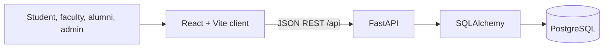

# CampusBridge requirements and design analysis

## Source documents and instruction boundary

The user asked for an application based on the attached project material and explicitly selected React for the frontend, FastAPI for the backend, and PostgreSQL for persistence. The report also names the same stack. The PDFs are source material describing the intended product, its requirements, visual references, and its academic project plan. Their internal milestones, proposed testing language, sample metrics, and descriptions are not separate commands to the implementation agent or evidence that those activities have occurred.

- `Campus Bridge Main.pdf` is a 14-page set of screen mockups. It contains seven unique mockups; pages 8–14 repeat the previous sequence.
- `CampusBridge Final Report.pdf` is a 74-page FYP-1 report. It provides the product rationale, requirements, use cases, and eight written prototype specifications.

The main mockup file visually covers login, home feed, student profile, faculty directory, faculty availability and schedule, faculty collaboration, and post creation. The report also specifies a faculty profile screen, but the mockup PDF does not show that screen. This implementation includes a faculty profile using the report's written specification and the visual language of the other mockups.

## Product intent

CampusBridge is a university-bounded academic networking system intended to reduce fragmented communication between students, faculty, and alumni. Its central value is the combination of:

1. A searchable faculty directory with qualifications, expertise, office location, weekly schedule, and manually maintained availability.
2. Context-aware student, faculty, and alumni profiles that identify a user's institutional role.
3. A cross-role discussion feed for academic questions, guidance, research, and alumni insight.
4. A request workflow for student-to-faculty consultation and faculty-to-faculty collaboration.
5. Campus-aware discovery and activity across one university network.

This scope differentiates the intended product from a static faculty listing, a course-only LMS, a general research network, a chat workspace, or a standalone scheduling tool. The report repeatedly emphasizes institutional data control and local hosting.

## Actors and access boundaries

| Actor | Intended work | Implemented access |
| --- | --- | --- |
| Student | Maintain academic profile; find faculty; create/comment on posts; request guidance; see schedules and availability | Feed, directory, profile, post composer, saved discussions, consultation request list and creation |
| Faculty | Maintain professional profile, schedule, and availability; respond to students; publish collaboration requests | All common modules plus schedule editor, consultation approval queue, and collaboration network |
| Alumni | Maintain passing-year identity; contribute career and academic insight; participate in discussions | Common feed, profile, posting, commenting, and directory access |
| Admin | Manage accounts and faculty verification; moderate posts | Admin console with user search, verify/unverify, activate/deactivate, and post removal |
| System admin | Manage system-level roles and infrastructure | Admin console account controls; infrastructure backup, recovery, and monitoring remain out of scope |

The report has a small mismatch in its actor descriptions: registration requirements cover students, faculty, and alumni, while login also mentions Admin. It does not define exact permissions for every actor. The implementation assigns public registration only to student, faculty, and alumni; administrator accounts are seeded or administered. Faculty accounts start unverified and are omitted from the public directory until an administrator verifies them.

## Functional requirements mapped to the prototype

The report lists 18 functional requirements and 22 use cases. The following maps the core FRs to the implemented product:

| Report requirement | Implementation |
| --- | --- |
| FR1–4: registration, login, session, logout | Email/password registration, PBKDF2 password hashing, signed expiring bearer sessions, client logout; faculty registration awaits verification |
| FR5–8: faculty and student profile management, alumni profile, central faculty data | PostgreSQL user profiles with role-specific fields, department, campus, expertise, qualifications, room, schedule, and availability |
| FR9–11: create posts, comment, view feed | Categorized posts, tags, resource links, comments with role identity, likes, saves, and campus/category feed filters |
| FR12: faculty search | Search by name, designation, department, bio, and expertise; filters for department, expertise, campus, and availability |
| FR13 and FR17: availability and schedules | Faculty-controlled status and weekly schedule blocks displayed on faculty profiles |
| FR14: faculty-to-faculty assistance | Verified faculty publish cross-department opportunities; other faculty can respond and connect |
| FR15: role identity | Student semester/program, faculty designation, and alumni passing year badges |
| FR16: multi-campus support | Campus labels on profiles and posts; campus filters on the feed, directory, and collaboration requests |
| FR18: admin user management | Search accounts, verify faculty, deactivate/reactivate accounts, and moderate posts |

The report's use cases also include generating reports, managing departments and announcements, managing system administrator accounts, database maintenance, backup/recovery, and system monitoring. Those are not implemented; the UI does not claim they are operational.

## Prototype screens

1. **Authentication:** split-screen branding, sign-in/create-account tabs, role/campus selection during registration, and sample scale indicators.
2. **Home feed:** category and campus filters, author role badges, posts, comments, reactions, saves, active faculty, events, and trending topics.
3. **Faculty profile:** verified identity, credentials, expertise, location, weekly schedule, availability, and a consultation request form.
4. **Student profile:** academic profile fields, progress and activity summaries, achievements, connections, and interests.
5. **Academic post composer:** title/content validation, 500-character body, category, campus visibility, tags, resource links, and publishing.
6. **Faculty directory:** search, statistics, department/expertise/campus/availability filters, profile cards, and consultation entry points.
7. **Faculty availability dashboard:** status control, office details, weekly blocks, student-facing preview, and consultation queue actions.
8. **Faculty collaboration network:** faculty-only opportunity form, categories, priorities, search/filter, request details, and responses.
9. **Admin console:** account verification/access controls and post moderation, added to cover report use cases absent from the supplied mockups.

## Design observations

The mockups use a light canvas, navy text, blue action color, soft borders, rounded cards, and clear role/status chips. The directory is information-dense and should retain its filters on desktop while collapsing them for narrow screens. The faculty dashboard is the most operationally complex screen: its schedule, availability toggle, office details, student preview, and consultation queue all need distinct visual grouping. The collaboration screen is explicitly restricted to verified faculty. The implementation follows those patterns and adds responsive layouts for smaller viewports.

## Application architecture

The requested stack is also the stack named in the report. The prototype keeps the browser client, API, and relational storage as separate services:

The PostgreSQL schema is centered on `users`, `posts`, `comments`, `post_likes`, `saved_posts`, `guidance_requests`, `collaboration_requests`, and `collaboration_responses`. Profile fields hold role-specific identity, campuses, expertise, faculty availability, schedule blocks, and consultation preferences. Posts and discussions remain separate from the two request workflows so their access rules can be enforced independently.

Sample counts such as 10,000 students and 50,000 discussions, sample achievements, event entries, and profile statistics are prototype content from the mockups. The application labels the login numbers as sample figures and seeds demo accounts and posts rather than presenting them as live institutional data.

## Non-functional requirements and design response

- **Performance:** the report targets authentication within five seconds and responsive searching/feed navigation. The app indexes user email/role and post author/date fields and limits list results. No performance or load measurement has been run.
- **Usability:** consistent navigation, readable role labels, clear empty states, validation, responsive layouts, and keyboard-visible focus styles support the three primary user groups.
- **Security:** passwords use salted PBKDF2 hashes; bearer tokens are HMAC-signed and expire; API routes enforce roles; faculty directory visibility depends on verification; input lengths are constrained. The app is configured for local development and does not yet provide TLS, token revocation, actual university-domain verification, OAuth, or email delivery.
- **Reliability:** relational records are persisted in PostgreSQL, while SQLAlchemy creates the initial schema. The report's backup/recovery and monitoring use cases need a later operations pass; no migration or backup workflow is included.
- **Institutional data control:** Docker Compose runs the database locally. A university deployment still needs approved infrastructure, secrets, domain, TLS, retention, and backup policies.

## Assumptions and deferred decisions

1. No approved university email domain or proof-of-enrollment integration is named, so registration validates email format but does not prove institutional identity.
2. Google/Microsoft buttons are visual affordances in the mockup, but the report gives no OAuth tenant/client credentials. The app explains that those integrations are pending.
3. Password reset, real-time email/in-app push notifications, uploaded file storage, calendar invitations, and external directory sync require providers or storage decisions absent from the PDFs.
4. The report says “real-time availability,” but also says faculty manually update status. The prototype uses a manual status toggle and persisted schedule rather than presence sensing.
5. “All campuses” is treated as a shared network scope. Campus-specific posts can still be filtered by the selected campus.
6. Admin/system-admin permissions are intentionally conservative. Policy management, report export, department CRUD, announcements, DB maintenance, and backups require explicit institutional rules and are deferred.

## Suggested implementation sequence

The report proposes an Agile sequence: authentication and profiles, discussion/feed, faculty availability/scheduling, alumni participation, faculty collaboration, role dashboards, multi-campus filters, then integration/UAT and local deployment. The current code establishes the core user journeys and local database foundation; a follow-up should add schema migrations, formal notification delivery, attachment storage, comprehensive admin operations, and acceptance criteria agreed with the university.
